# Contract Service

A Java / Spring Boot backend for the Seventh Ray internship assignment.

**What it does**

1. Upload a contract (PDF, DOCX or DOC) and store it.
2. Move its status through the workflow **DRAFT → REVIEW → APPROVED**.
3. Fetch contracts and their status history.
4. Ask plain-English questions about a contract and get the matching clause back.

## Live demo

- **Deployed app (Swagger UI):** https://contract-service-q04t.onrender.com/swagger-ui/index.html
- **API base URL:** https://contract-service-q04t.onrender.com/api/contracts
- **Demo video:** https://drive.google.com/file/d/10YKbmYCCcdt8pR_O-m0TWSAFlUH24SGh/view?usp=drivesdk
- **Hosting:** Render (free web service), built from this repository.

> **Note for assessors:** the app runs on Render's free plan, so it sleeps after
> ~15 minutes of inactivity. The first request can take up to a minute to wake it.
> Please wait and retry once if the page spins.

## Tech

Java 17+ · Spring Boot 3.3 · Spring Data JPA · H2 (file database) · Apache PDFBox 3 (PDF) · Apache POI 5 (DOCX/DOC) · springdoc-openapi (Swagger UI) · JUnit 5 + MockMvc.

## Run it locally

Requires JDK 17 or newer and Maven 3.8+.

```bash
mvn test            # unit + API tests
mvn spring-boot:run # starts on http://localhost:8080
```

Swagger UI: http://localhost:8080/swagger-ui/index.html

Data is kept in `./data` (database) and `./uploads` (original files). Delete both folders to reset.

## Deployment

- **Platform:** Render, web service connected to this GitHub repo (auto-deploys on push to `main`).
- **Build command:** `mvn clean package -DskipTests`
- **Start command:** `java -jar target/*.jar`
- **Prerequisites to run locally:** JDK 17+ and Maven 3.8+. No other setup, since the database is embedded.
- **Limitations of the hosted version:**
  - Render's free disk is not persistent. Uploaded files and the H2 database reset whenever the service restarts or redeploys, so contract IDs start again from 1.
  - Cold start after inactivity (see the note above).
  - Files are limited to 10 MB.

## Demo screenshots

The test suite passed with 13 tests, 0 failures, 0 errors, and 0 skipped. The startup and API walkthrough screenshots are included below in order.

<details>
<summary>Application started on port 8080</summary>
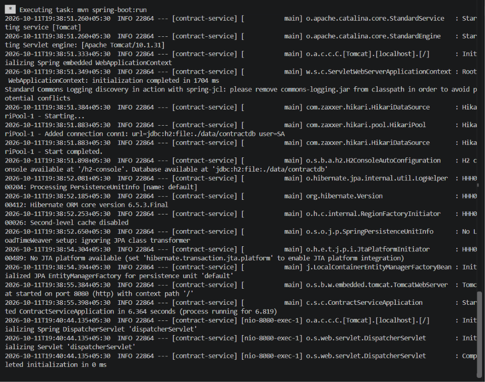
</details>

<details>
<summary>1. Upload PDF — HTTP 201, contract 1 in DRAFT</summary>
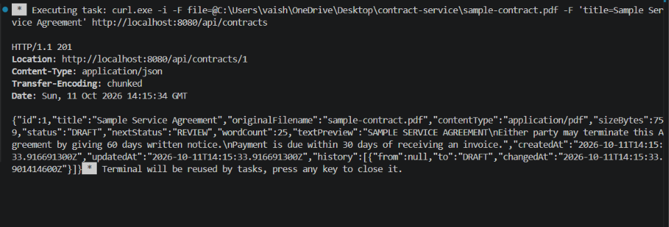
</details>

<details>
<summary>2. Upload DOCX — HTTP 201, contract 2 in DRAFT</summary>
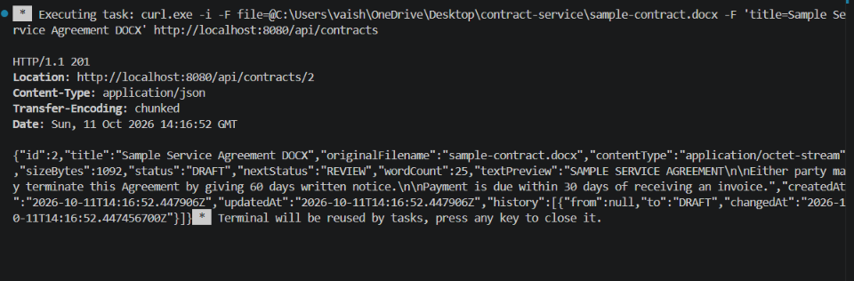
</details>

<details>
<summary>3. Get contract 1 — metadata and initial history</summary>
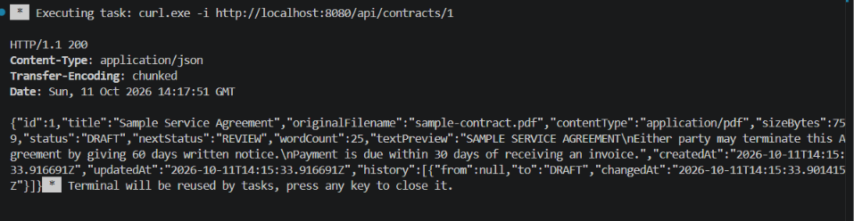
</details>

<details>
<summary>4. Move contract 1 to REVIEW</summary>
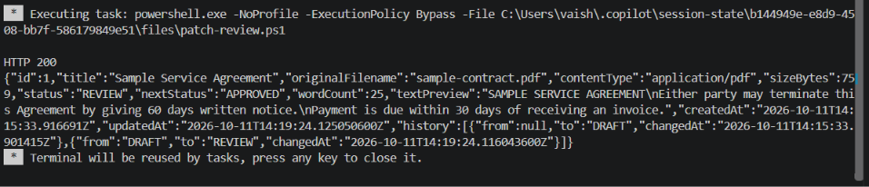
</details>

<details>
<summary>5. Move contract 1 to APPROVED</summary>
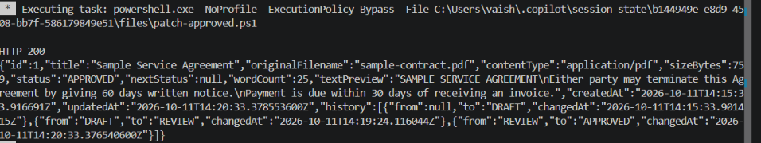
</details>

<details>
<summary>6. Verify full DRAFT → REVIEW → APPROVED history</summary>
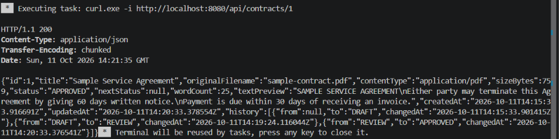
</details>

<details>
<summary>7. Ask about the termination notice period — answer found</summary>
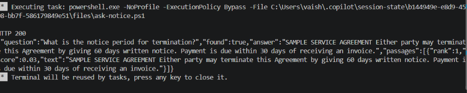
</details>

<details>
<summary>8. Ask about governing law in Mars — no answer found</summary>
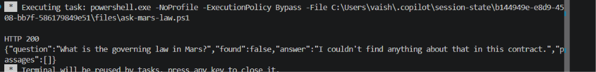
</details>

<details>
<summary>9. Reject an illegal DRAFT → APPROVED jump — HTTP 400</summary>
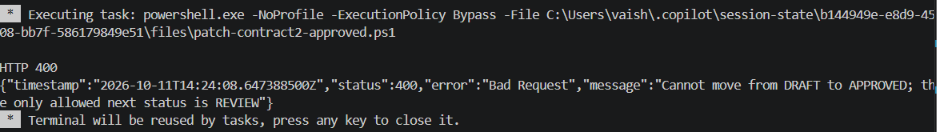
</details>

<details>
<summary>10. Reject a plain-text upload — HTTP 400</summary>
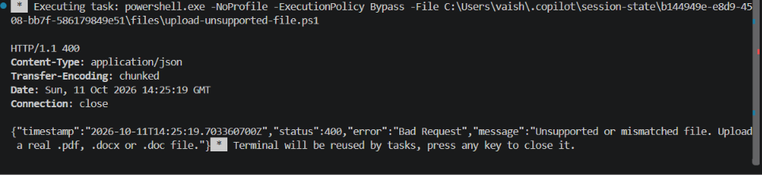
</details>

## API

| Method | Path | Purpose |
|---|---|---|
| POST | `/api/contracts` | Upload a contract (multipart: `file`, optional `title`). Returns 201, status `DRAFT`. |
| GET | `/api/contracts` | List contracts. Optional `?status=` with `DRAFT`, `REVIEW` or `APPROVED`. |
| GET | `/api/contracts/{id}` | One contract: metadata, status, next allowed status, history, text preview. |
| PATCH | `/api/contracts/{id}/status` | Body `{"status":"REVIEW"}`. Moves one step forward only. |
| POST | `/api/contracts/{id}/ask` | Body `{"question":"..."}`. Returns the best answer and top 3 passages. |
| GET | `/api/contracts/{id}/text` | Full extracted text. |
| GET | `/api/contracts/{id}/file` | Download the original file. |

### Try it with curl

```bash
curl -F "file=@contract.pdf" -F "title=Vendor agreement" http://localhost:8080/api/contracts

curl http://localhost:8080/api/contracts/1

curl -X PATCH http://localhost:8080/api/contracts/1/status \
     -H "Content-Type: application/json" -d '{"status":"REVIEW"}'

curl -X POST http://localhost:8080/api/contracts/1/ask \
     -H "Content-Type: application/json" -d '{"question":"What is the notice period for termination?"}'
```

Example answer:

```json
{
  "question": "What is the notice period for termination?",
  "found": true,
  "answer": "3. Termination Either party may terminate this Agreement by giving 60 days written notice.",
  "passages": [ { "rank": 1, "score": 0.41, "text": "..." } ]
}
```

Errors always come back as JSON: `{ timestamp, status, error, message }`
(400 bad input or illegal status move, 404 unknown id, 413 file over 10MB, 422 unreadable document).

## How it works

- **Architecture.** A layered Spring Boot service: controllers expose the REST endpoints, services hold the workflow, search and file handling, a parser layer reads documents, and Spring Data JPA persists the data. A global exception handler returns consistent JSON errors.
- **Parsing.** The file type is checked from its first bytes *and* its extension, so a renamed `.txt` is rejected. PDFBox extracts PDF text; POI extracts DOCX (paragraphs and tables, in order) and DOC. Scanned, image-only PDFs have no text layer and are rejected with a clear message (OCR is out of scope).
- **Storage.** The original file is saved on disk under a random UUID name (the user's filename is never used as a path, which prevents path traversal). Metadata and extracted text are saved in the database.
- **Workflow.** `ContractStatus` allows exactly one move from each state; every change is recorded in a `status_changes` table.
- **Q&A (keyword search, no external AI).** The contract is split into passages (headings are joined to the paragraph below). The question and passages are lower-cased, stop-words removed and lightly stemmed ("terminate", "termination", "terminated" all match). Passages are ranked with BM25, so rare words count more than common ones, and a small synonym list maps everyday words to contract language ("how long" → term/duration, "cancel" → terminate). If nothing matches, it returns `found: false` instead of guessing.

## Improvement added: Swagger UI

I added **Swagger UI** (springdoc-openapi) so every endpoint can be tested from the browser with no extra tools such as Postman or curl. It documents the request and response formats, supports file upload, and is what I used in the demo video.

- Local: http://localhost:8080/swagger-ui/index.html
- Live: https://contract-service-q04t.onrender.com/swagger-ui/index.html

## Test results

`mvn test` result: **Tests run: 13, Failures: 0, Errors: 0, Skipped: 0** → BUILD SUCCESS

| Test class           | What it covers                                                                                                   |
| -------------------- | ---------------------------------------------------------------------------------------------------------------- |
| `ContractStatusTest` | Allowed and rejected status transitions                                                                          |
| `QaServiceTest`      | Passage ranking, synonyms, the "not found" case                                                                  |
| `ContractApiTest`    | Upload PDF/DOCX, fetch, status update, invalid file, invalid transition, question with no answer in the document |

**Manual end-to-end checks (shown in the demo video):** PDF upload (201, DRAFT), DOCX upload, fetch with history, DRAFT → REVIEW → APPROVED, filter by status, answered questions, `found: false` for a question not in the document, 400 on DRAFT → APPROVED, and rejection of a `.txt` file and a text file renamed to `.pdf`.

## Design decisions and limits

- **Forward-only workflow** follows the brief literally. Allowing "send back to DRAFT" would be a one-line change in `ContractStatus`.
- **No authentication.** Out of scope for the 48-hour brief; the next step would be Spring Security with roles (e.g. only a reviewer can approve).
- **H2 file database** keeps setup to zero. Switching to PostgreSQL only needs the datasource properties and driver. On the free Render plan the data is not persistent (see Deployment).
- **Q&A is lexical.** It will miss questions whose words never appear in the contract. The natural upgrade is embeddings or an LLM over the top passages already returned by `QaService`; the retrieval step would stay the same.
- **Scanned PDFs** are not supported (no OCR).
- **Ideas for later:** pagination on the list endpoint, OCR for scanned files, Dockerfile.

## Project layout

```
src/main/java/com/seventhray/contracts/
  controller/   REST endpoints
  service/      ContractService (workflow), QaService (search), FileStorageService
  parser/       DocumentParser (PDF / DOCX / DOC)
  model/        Contract, StatusChange, ContractStatus
  repository/   Spring Data repository
  dto/          request / response records
  exception/    error types + global JSON error handler
src/test/java/  QaServiceTest, ContractStatusTest, ContractApiTest
```
